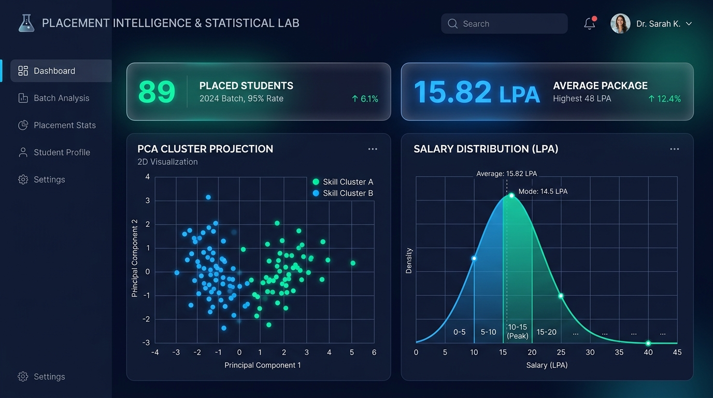
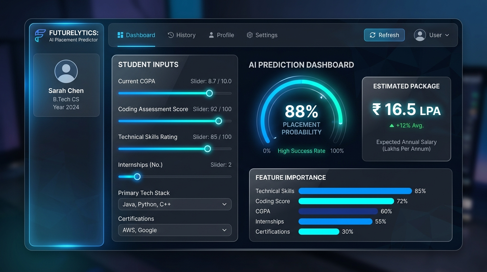
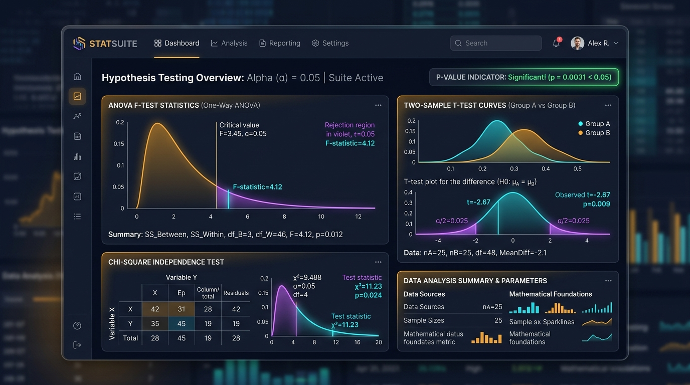
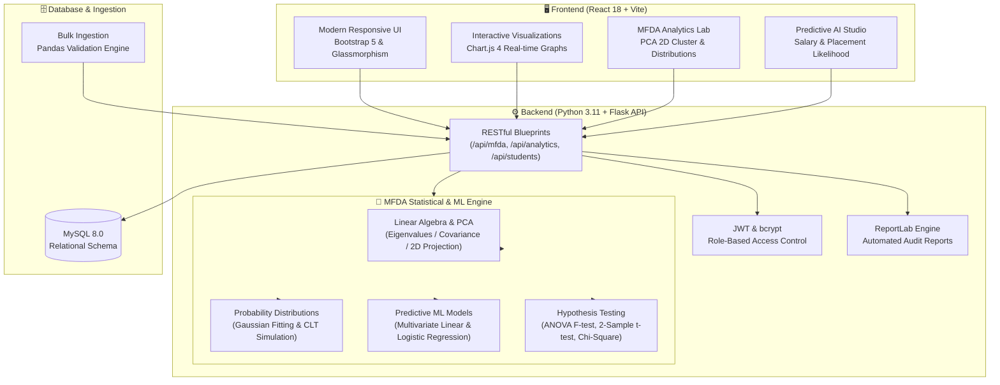

# 🎓 College Placement Analytics & MFDA Intelligence Suite

<div align="center">

[](https://college-placement-mfda.onrender.com)
[](https://github.com/Abhishek7439/college-placement-analytics)
[](https://www.python.org/)
[](https://react.dev/)

</div>

> 🚀 **Live Production URL:** [https://college-placement-mfda.onrender.com](https://college-placement-mfda.onrender.com)  
> 🔑 **Demo Admin Credentials:** Username: `admin` &bull; Password: `Admin@1234`

A full-stack, enterprise-grade web application for campus placement intelligence, predictive modeling, and rigorous statistical analysis — powered by **Mathematical Foundations of Data Analytics (MFDA)**, machine learning inference, interactive dashboards, bulk CSV/XLSX imports, and automated PDF reporting.

---

### 📸 System Preview

<div align="center">

| 📊 **MFDA Analytics Lab** | 🤖 **AI Placement & Salary Predictor** | 🧪 **Hypothesis Testing Suite** |
| :---: | :---: | :---: |
|  |  |  |

</div>

---

## 🏗️ Architecture & Analytical Pipeline



---

## 🚀 Tech Stack

| Layer | Technology |
|---|---|
| **Frontend** | React 18, Vite, React Router v6 |
| **UI / Charts** | Bootstrap 5, Bootstrap Icons, Chart.js 4 |
| **Backend** | Python 3.11+, Flask 3.0, Gunicorn |
| **Auth** | JWT (Flask-JWT-Extended), bcrypt |
| **ORM / DB** | SQLAlchemy, Flask-Migrate, MySQL 8.0 |
| **Statistical & ML** | SciPy, scikit-learn, NumPy, Pandas |
| **PDF Reports** | ReportLab |
| **Deployment** | Docker, Docker Compose, Nginx |

---

## ✨ Key Features

### 📐 MFDA Statistical & AI Lab
- **Linear Algebra & Dimensionality Reduction**: Real-time Principal Component Analysis (PCA) projecting high-dimensional student profiles (CGPA, internships, projects, hackathons, backlogs) onto 2D space with variance ratios.
- **Probability Distributions**: Gaussian fitting on placement packages with theoretical vs. empirical probability density functions (PDF).
- **Sampling & Central Limit Theorem (CLT)**: Dynamic sample size simulation demonstrating sample mean convergence to Gaussian normality.
- **Hypothesis Testing**: Automated two-sample t-tests, One-way ANOVA F-tests, Chi-square test of independence, and correlation matrices with exact p-value interpretation.
- **Predictive AI Engine**: Logistic regression placement probability gauge with feature importance breakdown + multivariate linear regression salary package estimator.

### 👩‍💼 Admin Portal (JWT Protected)
- Secure authentication with bcrypt password hashing
- Complete **CRUD** management for Students, Companies, Departments, and Placements
- **Bulk CSV / XLSX parser** with row-by-row validation, anomaly detection, and schema verification
- **One-click PDF generation** for department summaries, company audits, and placement logs

### 📊 Public Dashboard
- Real-time KPIs: Placement percentage, median/average/highest package (LPA), total offers
- Department-wise breakdown, sector distribution (IT, FinTech, Core, EdTech), and yearly recruitment trends


## 🗂️ Project Structure

```
college-placement-analytics/
├── backend/                  # Flask API
│   ├── app/
│   │   ├── models/           # SQLAlchemy models (Student, Company, Placement …)
│   │   ├── routes/           # Blueprints — auth, students, analytics, reports …
│   │   └── utils/            # analytics_service, report_generator, ai_insights
│   ├── schema.sql            # MySQL schema (auto-loaded by Docker)
│   ├── seed.py               # Creates DB tables + default admin
│   ├── requirements.txt
│   └── Dockerfile
├── frontend/                 # React + Vite SPA
│   ├── src/
│   │   ├── pages/            # admin/ and public/ page components
│   │   ├── components/       # charts/, common/ UI components
│   │   ├── context/          # AuthContext (JWT state)
│   │   └── api/              # Axios instance + API helpers
│   └── Dockerfile
├── sample_data.csv           # 50-student sample CSV for testing uploads
├── docker-compose.yml        # Dev / production stack
├── docker-compose.prod.yml   # Production overrides
├── .env.example              # Environment variable template
└── Makefile                  # Convenience commands
```

---

## ⚡ Quick Start

### Option A — Docker (Recommended)

**Prerequisites:** [Docker](https://docs.docker.com/get-docker/) & Docker Compose

```bash
# 1. Clone the repo
git clone https://github.com/Abhishek7439/college-placement-analytics.git
cd college-placement-analytics

# 2. Configure environment
cp .env.example .env
# Edit .env — fill in SECRET_KEY, JWT_SECRET_KEY, and DB credentials

# 3. Start all services
docker compose up --build
```

| Service | URL |
|---|---|
| Frontend (React) | http://localhost |
| Backend API | http://localhost:5000/api |
| MySQL | localhost:3306 |

```bash
# 4. Seed the database (first run only)
docker compose exec backend python seed.py
# Default admin → username: admin | password: Admin@1234
```

---

### Option B — Local Development (without Docker)

**Prerequisites:** Python 3.11+, Node.js 20+, MySQL 8.0 running locally

**Step 1 — Backend**
```bash
cd backend
python -m venv .venv

# Windows
.venv\Scripts\activate
# macOS / Linux
source .venv/bin/activate

pip install -r requirements.txt
cp .env.example .env        # fill in DATABASE_URL pointing to your local MySQL
python seed.py              # creates tables + default admin
python run.py               # Flask starts on http://localhost:5000
```

**Step 2 — Frontend** *(open a second terminal)*
```bash
cd frontend
npm install
npm run dev                 # Vite starts on http://localhost:3000
```

**Step 3 — Open in browser**

| URL | Page |
|---|---|
| `http://localhost:3000` | Public analytics dashboard |
| `http://localhost:3000/admin/login` | Admin login |
| `http://localhost:3000/admin/dashboard` | Admin panel (after login) |

> The Vite dev server proxies all `/api` requests to `http://localhost:5000` automatically — no extra configuration needed.

---

## 📂 Sample Data

A ready-to-use CSV file with **50 students** across 7 departments is included at [`sample_data.csv`](sample_data.csv).

**To use it:**
1. Log in to the admin panel
2. Go to **Upload Data** in the sidebar
3. First create the departments via **Departments** → Add (or they'll be created automatically if using the seed)
4. Upload `sample_data.csv`
5. The public dashboard will immediately show real data

**Required CSV columns:**
```
student_name, roll_number, email, department, batch_year,
company_name, package_lpa, year
```

**Optional columns:**
```
cgpa, sector, location, role, offer_date
```

---

## 🔌 API Endpoints

| Module | Base Path |
|---|---|
| Authentication | `POST /api/auth/login` |
| Students | `/api/students` |
| Departments | `/api/departments` |
| Companies | `/api/companies` |
| Placements | `/api/placements` |
| Analytics | `/api/analytics` |
| File Upload | `/api/upload` |
| Reports | `/api/reports` |

---

## 🗄️ Database

**Name:** `college_placement`  
**Tables (7):** `admins` · `departments` · `students` · `companies` · `placements` · `uploaded_files` · `reports`

The schema is in [`backend/schema.sql`](backend/schema.sql) and is automatically applied when the MySQL Docker container starts for the first time.

---

## 🔐 Security

| Concern | Implementation |
|---|---|
| Authentication | JWT Bearer tokens (8 hr expiry) |
| Passwords | bcrypt hashing |
| Secrets | `.env` file — **never committed to git** |
| CORS | Configurable origin whitelist via `CORS_ORIGINS` env var |
| File uploads | Extension whitelist (`.csv`, `.xlsx`), 32 MB max |
| Production | Startup assertions block weak default secret keys |

---

## 👤 Author & Maintainer

**Abhishek Kothe**
- GitHub: [@Abhishek7439](https://github.com/Abhishek7439)
- Repository: [college-placement-analytics](https://github.com/Abhishek7439/college-placement-analytics)

---

## 📄 License

This project is for educational purposes. Feel free to fork and extend.

---

<p align="center">College Placement Analytics & MFDA Intelligence Suite — Developed by Abhishek Kothe</p>
